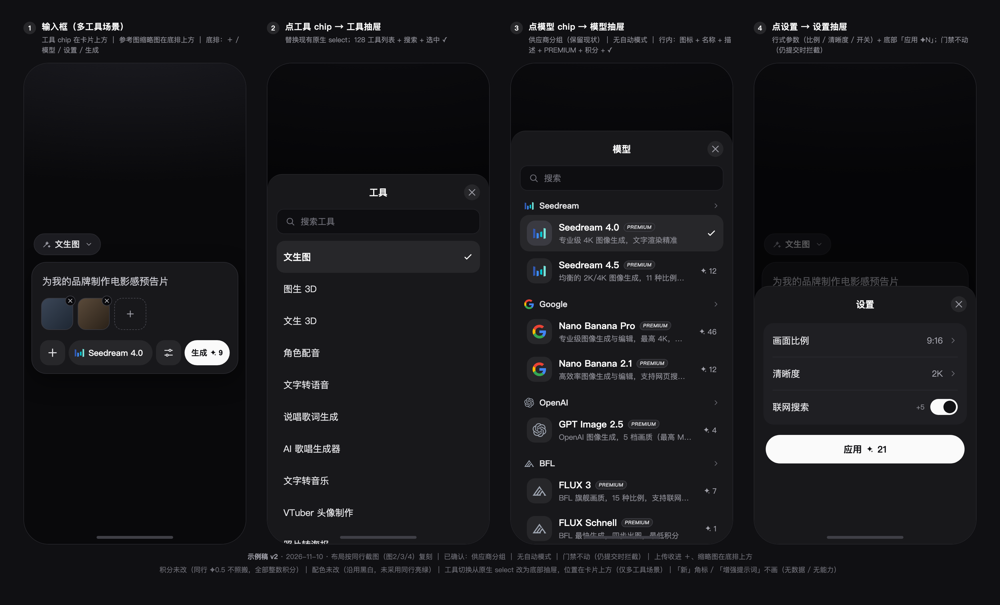

# 移动端输入框改版 · 1:1 复刻同行布局（执行清单 v4 · 已交付，2026-11-10）

> 状态：**已执行完成并交付**。用户 2026-11-10 19:2x 拍板：只改移动端（桌面不动）｜授权 32 语｜开始执行｜完成后本地 commit 并 push 远程（不 deploy）。
> 结果：arui `c6d5f90b4`（43 files）已 push 到 `origin/main`；全量门禁绿；真机/真实数据复核项见 §9 遗留项。
> 分派（已完成）：frontend task-5 → task-7 → task-8 → task-9（P1–P7）；backend task-6 只读复核。
> 本轮口径（用户 2026-11-10 确认）：
> 1. **积分完全不动**：`✦0.5` 是同行计价，我们保持现有整数积分；
> 2. **布局 1:1 复刻同行**（用户提供图2/3/4），不自行设计变体；
> 3. **已拍板**：上传按建议（`＋` 收进底排、缩略图在底排上方、上限文案移入弹层）｜模型抽屉**保留供应商分组**｜**自动模式不做**｜**门禁不动**（仍提交时才发现）；
> 4. 示例稿 v2（4 屏）见 §0；**只改移动端，桌面行为/样式不变**。
> 事实基线：arui `945ffb963`（工作区 clean、main 领先 origin/main 1 个既有 docs commit）、image-workers `05ac42f`（clean）、契约 v1.7.0。

---

## 0. 示例稿 v2（本轮产物，替代已删除的 v1）

文件：[mobile-prompt-mock-v2-2026-11-10.png](mobile-prompt-mock-v2-2026-11-10.png)（3500×2120，4 屏）

| 屏 | 内容 |
|---|---|
| ① 输入框（多工具场景） | 卡片上方 **工具 chip「文生图 ▾」**（仅多工具场景显示）｜参考图缩略图行（56px + 删除 × + `＋`）｜底排 `＋ 上传 / 模型 chip「Seedream 4.0」/ 设置圆钮 / 生成 ✦9` |
| ② 工具抽屉 | 标题「工具」+ X · 搜索工具 · 128 工具列表 · 选中 ✓（替换现在的**原生 select**） |
| ③ 模型抽屉 | 标题「模型」+ X · 搜索 · **供应商分组**（Seedream / Google / OpenAI / BFL…）· 44px 图标 + 名称 + 一句描述 + PREMIUM 弱化角标 + `✦N` 积分 + 选中 ✓（**无自动模式**） |
| ④ 设置抽屉 | 行式「画面比例 9:16 ›」「清晰度 2K ›」「联网搜索 [开关] +5」+ 底部「应用 ✦21」 |

示例稿的刻意说明：
- **配色未改**：沿用现有黑白体系（白 CTA / 深色底），未采用同行亮绿。
- **积分未改**：全部整数积分，真实 catalog 值（Seedream 4.0=✦9、4.5=✦12、Nano Banana Pro=✦46、Nano Banana 2.1=✦12、GPT Image 2.5=✦4、FLUX 3=✦7、FLUX Schnell=✦1）。
- **门禁未改**：模型行只保留 PREMIUM 角标（弱化描边），**不加锁、不提前弹门禁**；仍是提交时拦截（既定口径）。
- **「新」角标未画**：无上架时间数据源；**同行「增强提示词」未画**：平台无能力（示例用真实的「联网搜索」开关）。
- **工具切换位置是本稿的新提案**：现为底排左侧只读 pill / 原生 select；新稿移到**卡片上方 chip + 工具抽屉**，单工具页隐藏。

---

## 1. 检查结论（要点）

### 1.1 现状（arui，文件:行 级）

- 唯一组件 `app/components/prompt-bar/unified-prompt-bar.tsx`（3313 行），挂载：工具页 hero、首页/聚合页（`hero-prompt-section.tsx:193-206`）、画布底栏（`ai-canvas.$projectId.tsx:1282-1295`），134 个 route 引用。
- 底排单行横滚（`:2996-3018`）：工具切换（`:3021-3037`，**多工具时 CanvasDropdown，移动端是原生 `<select>`** `canvas/canvas-dropdown.tsx:243-271`；单工具页只读 span、无 truncate → 被裁 "Text to In…"）→ 模型（`:3042-3055`）→ 参数（`:3092-3100`）→ 滚动提示（`:3103-3116`）→ Generate（`:3121-3138`）。375px 下滚动区仅 ≈128–143px，**模型/参数 chip 初始在屏幕外**。
- 模型面板 = 桌面同款 anchored popover（`model-picker-panel.tsx` 465 行）：宽 343、`max-h 480`、无标题/搜索/自动模式/CTA；忽略 `visualViewport`（`use-anchored-popover.ts:56-63`）→ 键盘可遮挡；现按 **vendor 分组**（`model-picker-panel.tsx:178-206`）。
- 参数面板 = anchored popover（`param-settings.tsx` 445 行），比例网格、**即时生效、无 Apply**。
- 上传 = 卡片内 56px 大虚线方（`canvas/tilted-uploader-placeholder.tsx:22-70`）+ 下方「参考图最多 N 张」（`unified-prompt-bar.tsx:2823`）。
- 门禁：只在提交时拦（客户端 `:2323-2327` / 服务端 `api.ai.submit.tsx:277-303`）；模型行 premium 只有 PREMIUM 角标（`:415-429`）；128 个工具默认档**约 116 个 premium**。**本轮口径：不改门禁。**
- 响应式：prompt bar 内 0 个 `md:/sm:`；无 `visualViewport`；触摸目标 28–36px（<44px）。
- 抽屉原语：`app/components/ui/sheet.tsx` 有 `side="bottom"`（radix Dialog），默认 `h-auto border-t`，无 max-h/圆角/safe-area/键盘避让；先例 `mobile-nav.tsx:38`、`mobile-tab-bar.tsx:55-65`。
- 历史坑：2026-10-27「常驻展开 + flex-wrap」被整体回退（`progress.txt:3221/3235`），结论「移动端 chip 模式不适用，需纵向分区」——本方案走纵向抽屉，**不得**回到 flex-wrap 平铺。

### 1.2 与同行的差距

| 维度 | 现状 | 同行 | 差距 |
|---|---|---|---|
| 模型入口 | 横滚区第 2 项，首屏不可见 | 底排常驻 chip | **高**（开场死路） |
| 设置入口 | 横滚区 chip，不可见 | 底排常驻圆钮 | 高 |
| 工具切换 | 底排只读 pill / 原生 select | 无同类（同行单工具） | 需重新安置（示例稿：卡片上方 chip） |
| 模型面板 | anchored popover，无搜索/标题/CTA | 85% 底部抽屉 + 搜索 | **高** |
| 参数面板 | anchored popover、即时生效 | 行式 + Apply | 高 |
| 触摸目标 | 28–36px | ≥44px | 中 |

### 1.3 数据供给（backend 只读核对：**不需要契约 / 后端改动**）

- 契约 `ModelCatalogEntry` 没有 name/description/vendor/category/icon/eta/premium/isNew；展示信息全部来自 arui 静态配置（`model-branding.ts` / `model-premium.ts` / i18n / `nav-config.ts` / `tools.ts`），vendor 名被 BFF 主动过滤（`falModel` 不外泄）。
- 覆盖（可见档 1583）：name/icon/vendor 100%、description 97.9%（缺 33 档：background-remover 5 / handwritten 13 / id-photo 12 / transparent-bg 3）、eta 99.5%。
- 结论：抽屉所需「名称 / 描述 / 图标 / **vendor 分组** / 积分 / 选中态 / 画面比例」全部可由现有供给拼出；image-workers 子模块仍钉 1.6.0，本批**不需要 bump**、不改 `schema.ts`。

---

## 2. 复刻规格（以示例稿 v2 为准，逐项验收）

| # | 元素 | 规格 | 数据/实现落点 |
|---|---|---|---|
| S0 | 工具 chip | 卡片上方、左对齐：wand 图标 + 当前工具名 + `▾`；**仅多工具场景显示**；单工具页隐藏 | 现底排工具切换逻辑上移；`t(tool.labelKey)` |
| S1 | 底排顺序 | `＋` 上传 · 模型 chip · 设置圆钮 · 生成 CTA（四件一排，不横滚） | `unified-prompt-bar.tsx` 移动分支 |
| S2 | 模型 chip | 44px 高胶囊：品牌图标 18–20px + 当前模型名（15px，长名 truncate） | `getModelBranding().icon` + `getModelI18nKey` |
| S3 | 上传 | 底排 `＋`（44×44，圆角 15）替代大虚线框；上传后**缩略图行在卡片内、底排上方**（56px + 删除 × + `＋`）；「参考图最多 N 张」文案移入缩略图区/`＋` 弹层，不再常驻 | 复用现有 upload 逻辑 |
| S4 | 设置圆钮 | 44×44 圆角方，滑杆图标 | 打开设置抽屉 |
| S5 | CTA | 白底黑字胶囊：`生成` + `✦N`（整数积分） | 现有 `dynamicCreditCost`，不改计价 |
| S6 | 模型抽屉 | 底部 Sheet ≈85% 高、顶部圆角 26、标题「模型」居中 + 右上 X | 新增 `model-picker-sheet.tsx`，复用 `ui/sheet.tsx` |
| S7 | 抽屉搜索 | 44px 高搜索框，本地过滤名称/描述/供应商 | 纯前端（现面板无 input） |
| S8 | 供应商分组 | **保留现状**：分组头 = vendor 图标 + vendor 名 + 折叠箭头；组内按原顺序 | `model-picker-panel.tsx:178-206` 的 vendorGroups |
| S9 | 模型行 | 44px 图标方块 + 名称 16px + 一句描述 13px + PREMIUM 弱化角标 + 右侧 `✦N`；选中行灰底 + 白 ✓ | 复用抽出的 `model-list.tsx` |
| S10 | 无自动模式 | 抽屉顶部**不放**「自动模式」行 | — |
| S11 | 设置抽屉 | 底部 Sheet ≈54% 高：行式「画面比例 → 值 ›」「清晰度 → 值 ›」+ 布尔开关（有则显示）+ 底部「应用 ✦N」 | 新增 `param-settings-sheet.tsx`（草稿 state） |
| S12 | 参数即时性 | 移动端草稿 → 点「应用」才生效；关闭抽屉丢弃草稿；桌面保持即时生效 | 桌面行为不变 |
| S13 | 触摸目标 | 全部 ≥44×44 | 现 28–36px 需放大 |
| S14 | 键盘/safe-area | 抽屉与底栏避让软键盘、底部 safe-area | `visualViewport` / Sheet 增强 |
| S15 | 工具抽屉 | 底部 Sheet（≈77% 高）：标题「工具」+ X · 搜索工具 · 列表行 + 选中 ✓；替换原生 select | 新增 `tool-picker-sheet.tsx`，复用 `ui/sheet.tsx` |
| S16 | 门禁 | **不改**：无锁标、不提前弹窗；保留 PREMIUM 角标；仍提交时拦截 | 现有 `:2323-2327` / `api.ai.submit.tsx:277-303` 不动 |

---

## 3. 待确认（已全部确认，2026-11-10 19:2x）

| # | 事项 | 结论 |
|---|---|---|
| 1 | 示例稿 v2 定稿 | ✅ 按 v2 开工 |
| 2 | 工具切换位置：卡片上方 chip + 工具抽屉（单工具页隐藏、抽屉带搜索） | ✅ 采用 |
| 3 | 上传缩略图在底排上方一行；上限文案移入弹层 | ✅ 采用 |
| 4 | PREMIUM 弱化描边角标 | ✅ 采用 |
| 5 | 桌面同步 | ❌ 只改移动端；桌面行为/样式不变 |
| 6 | 授权 commit / 32 语 | ✅ 授权 32 语；完成后本地 commit + push 远程（不 deploy） |

已确认（无需再议）：积分不动 ｜ 供应商分组 ｜ 无自动模式 ｜ 门禁不动 ｜ 上传按建议 ｜ 不做「新」角标 ｜ 不做「增强提示词」 ｜ 不改配色。

---

## 4. 待办清单（P0–P7，每批独立验收后再问下一批 —— 踩坑 #1）

> 工作量粗估：P1≈1d、P2≈1d、P3≈1d、P4≈0.5d、P5≈0.5d、P6≈1d（i18n 大头）、P7≈0.5d；仅估算。

### P0 · 前置（无代码）
- [ ] 示例稿 v2 定稿确认（§3-1）
- [ ] §3 其余 5 项拍板
- [ ] 授权范围：可改文件 / 是否 commit / 是否只本地
- [ ] i18n key 草案（预计新增 6–12 条 × 32 语）+ 复用清单

### P1 · 组件抽取（桌面行为零变化）
- [ ] 从 `model-picker-panel.tsx` 抽 `model-list.tsx`：无锚定列表 + vendor 分组 + 行（图标/名称/描述/PREMIUM/积分/✓），桌面 popover 与移动抽屉共用
- [ ] 从 `param-settings.tsx` 抽 `param-sections.tsx`（比例/画质/数量/开关），桌面 popover 仅包装
- [ ] 工具列表抽 `tool-list.tsx`（现在 `CanvasDropdown` 的 options 结构）
- [ ] `ui/sheet.tsx` 增加 bottom 增强（max-h/圆角/safe-area/键盘避让）——**不改默认值**（`mobile-nav` / `mobile-tab-bar` 在用），用 className 或新 variant
- [ ] 新增 `model-picker-sheet.tsx` / `param-settings-sheet.tsx` / `tool-picker-sheet.tsx` 骨架
- [ ] 验收：桌面模型 popover（↑↓/Esc/outside-click）、参数 popover 行为不变；`tsc` 通过；`verify:branding` / `verify:premium` PASS

### P2 · 移动端底排复刻（S1–S5、S13）
- [ ] `unified-prompt-bar.tsx` 增加移动分支：底排 = `＋` / 模型 chip / 设置圆钮 / `生成 ✦N`
- [ ] 模型 chip 常驻、显示当前模型名（长名 truncate）
- [ ] 参考图：大虚线框 → 底排 `＋`；缩略图行在底排上方；上限文案移入缩略图区（S3）
- [ ] 移动端移除横向滚动提示箭头；桌面保留
- [ ] 触摸目标 ≥44×44
- [ ] 验收：375/390/430 截图；无横向裁切；四类挂载点（首页/聚合页/工具页/画布）表现一致

### P3 · 模型抽屉复刻（S6–S10）
- [ ] 底部 Sheet：标题「模型」+ 关闭、搜索、**供应商分组**、模型行、选中 ✓、可滚动
- [ ] 搜索：本地过滤名称/描述/供应商
- [ ] 行内信息：44px 品牌图标 + 名称 + 一句描述 + PREMIUM 弱化角标 + `✦N` 积分
- [ ] 无自动模式（不渲染该行）
- [ ] 选中态：选中行灰底 + ✓；打开抽屉时定位到当前模型
- [ ] 验收：与示例稿屏③逐项比对；17 档真实数据渲染无溢出；长名/长描述截断正常

### P4 · 设置抽屉复刻（S11–S12）
- [ ] 行式参数：画面比例（9:16 等，值 + 展开）、清晰度/分辨率、数量（有则显示）、布尔开关（有则显示，如「联网搜索 +5」）
- [ ] catalog 无 `aspect_ratio` 的 32 档（固定画幅）隐藏该项，不渲染空行
- [ ] 草稿 state：改动 → 底部「应用 ✦N」才写回；关闭抽屉丢弃；桌面保持即时生效
- [ ] 同行「增强提示词」**不做**（无平台能力，不画假开关）
- [ ] 验收：改参数后生成，`request-body.ts` 组包正确；底部费用 = `clientCalcCreditCost`；与示例稿屏④逐项比对

### P5 · 工具切换（S0、S15）
- [ ] 卡片上方工具 chip（仅多工具场景）：当前工具名 + `▾`，点击打开工具抽屉
- [ ] 工具抽屉：标题 + 搜索 + 列表 + 选中 ✓，替换原生 `<select>`；单工具页隐藏
- [ ] 选中后：关闭抽屉、刷新模型/参数列表、chip 与卡片标题同步
- [ ] 验收：首页/聚合页（多工具）切换 3 个不同工具，模型列表与参数区正确刷新；工具页无 chip；128 工具滚动/搜索无卡顿
- [ ] 说明：门禁不动（S16）——不改提交时拦截逻辑；首访用户仍可能在提交时遇到门禁弹窗，本批只保证"模型入口可见、可切非高级档"

### P6 · 数据 / i18n
- [ ] 33 档可见档缺描述：补 `model-branding.ts` 的 descriptionKey + i18n（或按工具决定接受无描述；不补不会报错，只会静默缺行 —— 踩坑 #7）
- [ ] 「新」角标：**不做**（无数据源）
- [ ] i18n 新增 key × 32 语（模型/工具/设置抽屉标题、搜索、应用等）；`I18N_VERSION` bump（现 `2026-11-10-4`，`app/config/i18n.ts:23`）
- [ ] 长词语言（de/ru/ar）chip / 行文案不溢出
- [ ] 验收：`lint:i18n` / `i18n:verify` / `lint:links` 全绿

### P7 · 守卫 / 回归 / 收尾
- [ ] `pnpm typecheck` / `pnpm build`
- [ ] `pnpm verify:branding` / `verify:premium` / `verify:brand-color`
- [ ] 与示例稿逐项比对（4 屏 17 条规格 S0–S16）
- [ ] 桌面回归：模型 popover 键盘导航、参数 popover、工具下拉、四类挂载点
- [ ] 真机：iOS Safari + Android Chrome；键盘弹起；深/浅主题；safe-area
- [ ] 踩坑 #7 复查：增删档位后面板不降级为 CanvasDropdown / 不落 "Arui" 兜底混组
- [ ] 本清单勾选 + progress 记录（契约未变，不改 CHANGELOG）

---

## 5. 风险与取舍

| 风险 | 说明 | 缓解 |
|---|---|---|
| 共享文件改动面大 | `unified-prompt-bar.tsx` 被 134 route + 首页 + 画布引用；`model-picker-panel.tsx` / `param-settings.tsx` 桌面在用；`ui/sheet.tsx` 被导航使用 | 先抽组件（桌面零变化）→ 再移动分支；`ui/sheet` 不改默认值；每批跑桌面回归 |
| 历史回退 | 2026-10-27 常驻展开 + flex-wrap 被整体回退 | 走「固定底排 + 纵向抽屉」，不做 flex-wrap 平铺；真机确认后再合并 |
| 工具切换改造 | 原生 select 换抽屉：128 工具长列表、搜索性能、i18n、选中刷新 | 抽 `tool-list.tsx` 复用；列表虚拟化视需要；单独 P5 验收 |
| 门禁不动 | 首访用户仍会在提交时撞门禁（本次不改口径） | 只保证模型入口可见 + 可切非高级档；若后续要提前提示，另立小批 |
| 上传交互变化 | 大虚线框改 `＋` 后，上限文案可见性下降 | 缩略图行 + 弹层文案；P2 单独验收 |
| 积分口径 | 用户明确不动；同行 `✦0.5` 不照搬 | CTA / 行内 / Apply 全部用现有整数 `creditCost` |
| i18n 工作量 | 6–12 key × 32 语 ≈ 192–384 条 | 复用已有 key 减少新增；按 `docs/多语言策略.md` 分批 |
| 描述缺口 33 档 | 不补则行内缺描述（静默） | P6 显式清单逐工具决定 |

---

## 6. 本批明确不做（边界）

- **不改积分 / 价格 / 计费口径**（用户口径：积分不动；`✦0.5` 不照搬）。
- **不改门禁**：不加锁标、不提前弹窗；仍提交时拦截。
- **不改契约**：`schema.ts` / `schema.zod.ts` / `CHANGELOG.md` / `scripts/smoke-test.ts` 不动；不 bump image-workers 子模块。
- **不改 image-workers**（及其它 worker 仓）：本改版无后端需求。
- **不做「自动模式」**（用户拍板）；**不做同行「增强提示词」**（平台无能力）；**不做「新」角标**（无数据源）。
- **不改配色**：保持现有黑白体系（未采用同行亮绿）。
- **不 push / 不 deploy / 不 sync catalog**；除非单独授权。
- 桌面端一期不改（除非 §3-5 另行拍板）。

---

## 7. 证据附录（本轮只读核对，0 文件改动）

- arui：`git status --porcelain` 前后为空，HEAD `945ffb963`；未起 dev server、未跑 typecheck/build、未联网。
- image-workers：`git status --short` 为空，HEAD `05ac42f`；未 deploy/sync/写 KV/重生成 registry。
- 契约仓：本轮新增本清单 + 示例稿 v2 PNG，已删除 v1；既有未提交改动（`CLAUDE.md`、`docs/踩坑集锦.md` 为 M，若干未跟踪 docs）与本批无关。
- 计数来源：`unified-prompt-bar.tsx` 3313 行 / `model-picker-panel.tsx` 465 行 / `param-settings.tsx` 445 行 / `canvas-dropdown.tsx`；128 个 `defaultModelId`、8 个非高级 tierId；可见档 1583、description 1550、eta 1575（backend 静态统计）。
- 示例稿生成：本地 HTML + 无头 Chrome 渲染，仅用于设计确认，未改任何产品代码。

---

## 8. 施工顺序（拍板后）

1. §3 六项拍板 + 示例稿 v2 定稿（P0）。
2. **P1 组件抽取**（桌面零变化）→ 验收 → 汇报。
3. **P2 底排复刻 + P3 模型抽屉**（同批发布，解决"首屏看不到模型"的核心问题）→ 真机验收。
4. **P4 设置抽屉 + P5 工具切换** → 验收。
5. **P6 数据/i18n** → **P7 守卫回归** → Lead 复核 diff + 跑全量门禁 → 本地 commit（明确路径）→ `git push origin main`（不 deploy / 不 sync）。

---

## 9. 执行记录（2026-11-10 19:53 完成）

| 任务 | 内容 | 负责人 | 状态 |
|---|---|---|---|
| task-5 · P1 | 组件抽取：`model-list.tsx` / `param-sections.tsx` / `tool-list.tsx` + `ui/sheet.tsx` drawer 变体 + 三个抽屉骨架 | frontend | ✅ 桌面零变化，typecheck/eslint 通过 |
| task-6 · P2+P3 | 移动端底排（`＋` / 模型 chip / 设置 / 生成）+ 模型抽屉（供应商分组、搜索、行、✓，无自动模式） | frontend | ✅ 375/390/430 实测无溢出，桌面 1280 回归通过 |
| task-7 · P4+P5 | 设置抽屉（行式 + 草稿 Apply）+ 工具 chip + 工具抽屉（替换移动端原生 select） | frontend | ✅ 草稿实测 12→18→23、Esc 丢弃、Apply 写回；单工具页无 chip |
| task-8 · P6+P7 | i18n 新增 key × 32 语 + `I18N_VERSION` bump + 全量门禁自查 | frontend | ✅ 32/32 locale 齐（4 key），全量门禁绿 |
| task-9 | 只读复核：7 档真实积分/参数/registry 未变，无契约/后端改动 | backend | ✅ 1592 entries；7 档数值与示例稿一致 |
| — | Lead 复核 diff + 跑门禁 + commit + push | Lead | ✅ arui `c6d5f90b4` 已 push |

**Lead 复核结果（在最终工作区实跑）**
- `pnpm typecheck` exit 0；`pnpm build` ✓ 59.18s
- `pnpm lint:i18n` exit 0（仅既有基线警告）；`i18n:verify` ✓ 32 locales × 154 ns = 4928 files OK；`lint:links` ✓ 176 路由
- `verify:branding` / `verify:premium` / `verify:brand-color` 全 PASS
- diff 审查：43 文件（37 M + 6 新增）；`isPremiumTier` / `PremiumRequiredDialog` / `checkCredits` / `INSUFFICIENT_CREDITS` 均无改动；桌面横滚工具栏仅外加 `{!isMobile && (...)}` 包裹、内部 DOM/class 未改；无 build 产物/临时文件入库。
- commit：arui `c6d5f90b4`（43 files, +1988/−605）→ push `70ae4986e..c6d5f90b4` main ✅（pre-push i18n/links 钩子通过）

**遗留项（不阻塞上线，需真机/真实数据复核）**
1. 本地 catalog 为请求级 stub（miniflare KV 空）：真实 17 档/128 工具数据下的模型行渲染与切工具 tier 刷新，部署后需在预览环境点一遍。
2. iOS Safari / Android Chrome 真机：抽屉 visualViewport 抬升与 safe-area 未真机验证（代码已实现，headless 无法模拟）。
3. 画布底栏（需登录 + 项目）未做视觉回归；组件同路径，建议真机点一次。
4. 登录态下移动 CTA 多 `✦N`，模型名会多截断（已 truncate 兜底不溢出）；de/ru 长语言下模型名更短，可接受。
5. 33 档缺描述按拍板未补（行内少一行描述，不报错）；「新」角标无数据源未做。
6. `progress.txt` 未更新（共享文档，按需补记）。
