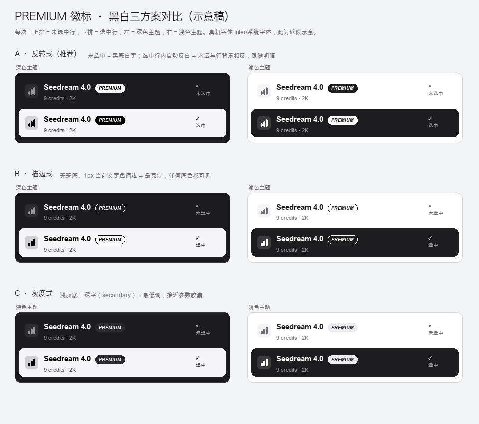

# 高级模型二期（视频积分 / 签名工具默认档 / 配色 / 付费门槛）· 待办清单（2026-11-09）

> 状态：**P4 + P5 + P6 已实现、已推送、已上线**（arui `fe0e17372`，2026-11-09 20:10）；**P7（Pro/Ultra 门槛）按用户要求延后**。详见 §7 实施记录。
> 上一批（PREMIUM 徽标）已上线：arui `9f21d1a78`（62 档里 54 个 premium）。
> 协作方式：ab-team（frontend = `/Users/nico/Desktop/arui`）。本批全部落在 arui + 文案，**backend 不参与**。
> **变更记录**：2026-11-09 19:14 用户修正需求 2 —— 原「128 个工具页默认档全部换成 premium」**撤回**，改为「仅 3 个签名工具默认选中 **Seedream 4.0**」。其余 38 个非 premium 默认档**保持不动**。
> **变更记录 2**：2026-11-09 19:33 用户指出主题是黑白 —— 上一版 §1.3 推荐「primary 紫」基于 `--primary:#635BFF` token，属误读；已更正为黑白方案（详见 §1.3）。
> **变更记录 3**：2026-11-09 19:54 用户拍板 —— 配色选 **A 反转式**；Free 用户「59 工具无免费档」**不处理**（后续会加免费档模型）；**弹窗先不做** → P7 整体延后；本轮执行 P4/P5/P6 并提交推送。
> 过程纪律：`docs/踩坑集锦.md` #1（未授权不派活）、#7（展示层漏配 = 静默降级）。

---

## 0. 需求复述（先确认理解一致）

| # | 你的原话 | 我的理解 | 现状 |
|---|---|---|---|
| 1 | 视频的模型，面板上都没显示积分 | 模型面板里视频档积分显示 `—`，要显示可读数字 | 根因已定位，§1.1 |
| 2 | email-signature-generator / signature-png-maker / signature-generator-cursive 这三个工具页默认选中 Seedream 4.0 | **只改这 3 个工具**的 `defaultModelId` → `seedream-4`；**其余 125 个工具默认档不动** | 这 3 个当前都是 flux-schnell（1 积分），§1.2 |
| 3 | 亮绿胶囊颜色改为跟随主题那个颜色 | PREMIUM 胶囊底色改成站点主题色（不再用固定亮绿 #D9E021） | 现在是固定亮绿，§1.3 |
| 4 | 高级模型只有 Pro、Ultra 用户才可使用；Free 用户点生成显示弹窗，哪怕积分够 | Free（含过期/欠费）选中 premium 档点生成 → 弹升级弹窗，**不提交、不扣费** | 现在无任何 plan 门槛，§1.4 |

> 注：#2 与本批 #4 有联动 —— 这 3 个工具的默认档将变成 premium（9 积分），Free 用户进页面首屏就会撞 #4 的弹窗，需手动切回 flux-schnell（1 积分）才能生成。见 §1.4 风险。

---

## 1. 检查结果（事实基线）

### 1.1 视频积分 — 根因与方案

**根因**：`panelCredits()`（`app/components/prompt-bar/model-picker-panel.tsx:102-111`）调用 `clientCalcCreditCost(tier.creditCost, {})`，而 `perSecond` / `perSecondMatrix` 规则**必须**有 `durationSec`（`app/lib/catalog/credit-cost.ts:79-100`），面板不传 → 返回 null → UI 显示 `—`。`perUnit` 有「取 table 最小值」兜底，所以只有视频是空的。

**影响面：12 个工具 / 142 档**

| 工具 | 档数 | 计价类型 |
|---|--:|---|
| 10 个 T2V 工具（text-to-video / text-to-animation / script-to-video / image-to-video / cartoon-video / anime-video / logo-video / video-ad / video-intro / video-script） | 14 ×10 | `perSecondMatrix`（resolution 维度） |
| `ai-video-to-video` | 1 | `perSecond`（kling v4v 43/秒） |
| `ai-video-background-removal` | 1 | `perSecond`（bria 15/秒） |

**参考数（kling-4.0）**：`{720p:48, 1080p:71}` 积分/秒，`duration` 默认 5s → 240 / 355 积分（不是 48/71 —— 那是每秒单价）。

**方案（需你选）**

| 方案 | 显示 | 例（kling-4.0） | 利弊 |
|---|---|---|---|
| **A（推荐）** 按该档默认参数折算一个数 | `240` | duration 默认 5s × 默认 resolution 单价 | 与图片 perUnit「取最低档」口径一致；不随用户改时长联动（图片也不随改分辨率联动） |
| B 显示每秒单价 | `48/秒` | — | 最诚实、最省事；但和图片/音频的"整次积分"混排，理解成本高 |
| C 显示起价 | `240 起` | min 每秒 × 最短可选时长 | 语义清晰；"起"字要 i18n（32 语） |

**改动面**：1 个函数（`panelCredits`）+ 可能 1 个 helper；**0 契约 / 0 后端**。

### 1.2 三个签名工具默认档 → Seedream 4.0

**目标工具（3 个，均已确认存在且 `seedream-4` 在其可选档池内）**

| 工具 slug | 当前默认 | 目标默认 | clientModelId |
|---|---|---|---|
| `ai-email-signature-generator` | `flux-schnell`（1 积分） | `seedream-4`（9 积分） | `arui-ai-email-signature-generator-seedream-4` |
| `ai-signature-png-maker` | `flux-schnell`（1 积分） | `seedream-4`（9 积分） | `arui-ai-signature-png-maker-seedream-4` |
| `ai-signature-generator-cursive` | `flux-schnell`（1 积分） | `seedream-4`（9 积分） | `arui-ai-signature-generator-cursive-seedream-4` |

**证据（线上 `/api/catalog/:toolSlug` 实测）**
- 3 个工具都是 17 档全池，`seedream-4` 在列；映射存在；`seedream-4` 是 `fixed 9` 积分、`premium`（不在非高级名单）。
- 参数对比（email-signature 工具）：

| | flux-schnell（现默认） | seedream-4（目标） |
|---|---|---|
| 积分 | 1 | **9** |
| 参数 | prompt / style(minimal) / colorScheme(black) / aspect_ratio(1:1) / resolution(1K) | 同结构，但 **resolution 默认 2K** |
| maxDimension | 1024 | 4096 |
| 支持参考图 | false | false |

→ 副作用：切换默认后**首屏积分 1 → 9**、默认分辨率 1K → 2K（用户可再改）。

**改动点**：`app/config/canvas-tools.ts` 3 行 `defaultModelId`（:356 / :367 / :1648）。

**同类工具现状（未列入本批，保持不动，供你确认是否要一起统一）**

| 工具 | 当前默认 | premium | 备注 |
|---|---|---|---|
| ai-electronic-signature-maker | seedream-4 | ✓ | 已符合 |
| ai-outlook-signature-generator | seedream-4 | ✓ | 已符合 |
| ai-gmail-signature-generator | seedream-4 | ✓ | 已符合 |
| ai-html-signature-generator | seedream-4 | ✓ | 已符合 |
| ai-professional-email-signature-generator | seedream-4 | ✓ | 已符合 |
| ai-handwritten-signature-generator | gpt-image-1-5（4 积分） | ✓ | 也是 premium，但**不是 seedream-4**；是否统一？ |
| 其余 38 个非 premium 默认档 | flux-schnell / seedance-1-pro-fast / recraft / qwen3-tts | ✗ | **按本次修正全部不动** |

> 背景数据（已实测，供参考、本批不执行）：全站仍有 **41/128** 工具默认档非 premium（flux-schnell 29 / seedance-1-pro-fast 9 / recraft-remove-background 2 / qwen3-tts 1）。原「全站统一 premium」方案已撤回。

### 1.3 配色 — **更正：主设计语言是黑白**（2026-11-09 19:33 用户指出）

**我上一版说错了**：上一版把 `--primary:#635BFF` 当成"主题色"推荐，只读了 token 没核对渲染层。实测（线上页面 HTML/CSS + 源码）结论：

| 位置 | 实际颜色 | 证据 |
|---|---|---|
| 工具页主 CTA（Start now / 生成） | **黑底白字 / 暗色白底黑字** | `app.css:547-573` `.btn-start-now`（`background-color:#000`，`.dark` 下 `#fff`）；`unified-prompt-bar.tsx:3111` 发送键 `bg-black text-white dark:bg-white dark:text-black` |
| 模型面板选中行 | **黑底白字（跟随明暗反转）** | `model-picker-panel.tsx:367` `bg-foreground text-background` |
| 面板/画布容器 | 黑白灰（`--background/--foreground/--secondary`） | `app.css:8-37`（Apple 式纯白基调 + 系统灰） |
| 价格页 CTA / "POPULAR" 徽章 | 紫色 #635BFF | `app.css:239-243` `.btn-gradient{background:var(--color-primary)}`；`pricing-section.tsx:260` |
| 少数旧组件（credits 弹窗 CTA、testimonials 徽章、features 图标圈） | 紫色 | `credits-exhausted-dialog.tsx:42`、`testimonials-section.tsx:67`、`features-section.tsx:54` |

结论：**设计系统是黑白（Apple 风），紫色 `--primary:#635BFF` 是脚手架遗留 token**，只在价格页 CTA/POPULAR 等少数位置存活，工具页面板的语境是纯黑白。所以「跟随主题」应理解为**黑白**，不是我上一版写的紫。

**示意稿（2026-11-09 生成，仅选型用）**： —— `docs/premium-badge-abc.png`（每块上=未选中行、下=选中行；左=深色主题、右=浅色主题）。

**更正后的候选（黑白三选一）**

| 候选 | 未选中行 | 选中行（黑底白字）内 | 备注 |
|---|---|---|---|
| **A 反转式（推荐）** | `bg-foreground text-background`（浅色=黑底白字 / 暗色=白底黑字） | 反色为 `bg-background text-foreground` | 完全跟随明暗、始终与行背景相反；需按 `isSelected` 切 1 个 class |
| B 描边式 | `border border-foreground/25 text-foreground`（无实底） | 同左 | 最克制，任何底上都可见；视觉权重最低 |
| C 灰度式 | `bg-secondary text-foreground` | 同左 | 低调，接近参数胶囊观感；"高级"感弱（选中白行上会变深灰胶囊） |

**改动面**：仍只动 `model-picker-panel.tsx` 徽标那一行 class（+ 选中态 1 个分支）；**不再需要新增 `--color-premium` token**（可直接删掉上一批加的两行，或保留但不用 —— 建议删，避免死 token）。

### 1.4 付费门槛 — 现状、链路、改动点

**计划体系**：`free`（每日 10 积分）/ `pro` / `ultra`（`app/config/pricing.ts:33-70`）。有效档位判断已存在：`getEffectiveTier()`（`app/lib/subscription.ts:45`）——取消/欠费/过期一律按 free。

**客户端已有 plan 数据**：`useLayoutContext()` 提供 `subscriptionPlanId` / `subscriptionStatus`（`app/contexts/layout-context.tsx:18-19`，布局 loader 已查，无需新接口）。

**提交链路**：工具页 `UnifiedPromptBar` 点生成 → **新 tab 打开画布** → 画布页 `POST /api/ai/submit`。所以要在两层拦：

| 层 | 位置 | 行为 |
|---|---|---|
| 客户端（体验） | `unified-prompt-bar.tsx:2311` 的额度检查**之前** | 选中的档是 premium 且有效档=free → 调 `onPremiumRequired?.()`，弹窗、return、不发请求 |
| 服务端（权威） | `api.ai.submit.tsx`（catalogEntry 解析后、积分检查 `:456` **之前**） | premium 档 + free → `403 PREMIUM_PLAN_REQUIRED`，不建记录、不扣费 |
| 画布页 | `ai-canvas.$projectId.tsx:697`（现有 `INSUFFICIENT_CREDITS` 分支旁） | 收到 `PREMIUM_PLAN_REQUIRED` → 弹同一弹窗 |

**弹窗**：仿 `app/components/marketing/credits-exhausted-dialog.tsx` 新建 `PremiumRequiredDialog`（CTA → `/pricing`）。需要新增 i18n key（`common.json` `credits.dialog.*` 同族）；en 源必加，31 语可先回退（`lint:i18n` 非 en 缺失只 warn）。

**服务端实现注意**：`tier` 目前在 `api.ai.submit.tsx:540` 才算（在积分检查之后）。需要把 user 订阅查询（现有 `Promise.all` 里已经查了 `subscription_status/plan_id`）**前移到积分检查之前**，否则「积分不足 + 免费用户」会先报积分错误。

**本批相关的可用性影响（口径已收敛）**
- 只有 3 个签名工具默认档变 premium（首屏 9 积分）→ Free 用户进这 3 个页面点生成会撞弹窗，但**可切 flux-schnell（1 积分）继续用**。
- 与 41/128 非 premium 默认无关；但**59/128 个工具没有任何非 premium 档**（3D 全部、singing / text-to-music、签名族以外多数上传型 I2V 等）→ Free 用户在这些工具上仍完全无法生成（这是 #4 的固有效果，与 #2 修正无关）。是否接受 / 是否在弹窗加「使用免费模型继续」，见 §3-5。

---

## 2. 待办（分批，每批单独授权）

### 批次 P4 · 视频积分 ✅ 已上线（方案 A）
- [x] `panelCredits()` 支持 `perSecond` / `perSecondMatrix`（方案 A：默认参数折算 + `43/s`）
- [x] 默认值表从 `tier.params` 的 `defaultValue` 收集（`duration` → `durationSec`）
- [x] 线上数据核对 5 样本：340 / 355 / 195 / 43/s / 15/s；10 个 T2V 工具 140 档无 `—`
- **验收**：✅ 12 个视频工具 142 档不再出现 `—`；图片 17 档 / 音频 8 档 / 固定价视频档旧值不变

### 批次 P5 · 三个签名工具默认档改 Seedream 4.0 ✅ 已上线
- [x] `ai-email-signature-generator`（:1648）→ `arui-ai-email-signature-generator-seedream-4`
- [x] `ai-signature-png-maker`（:367）→ `arui-ai-signature-png-maker-seedream-4`
- [x] `ai-signature-generator-cursive`（:356）→ `arui-ai-signature-generator-cursive-seedream-4`
- [x] 线上 catalog 核对：3 个工具默认档均命中 `seedream-4`；首位积分 9；handwritten 未动
- [ ] 可选守卫：断言这 3 个工具默认档（**未做**，本轮最小改动）
- **验收**：✅ 3 个工具页默认档正确；其余 125 个工具 `defaultModelId` 零变化（`git diff` 仅 3 行）

### 批次 P6 · 配色 ✅ 已上线（方案 A 黑白反转）
- [x] 徽标改黑白反转（未选中 `bg-foreground text-background`，选中行 `bg-background text-foreground`），删除 `--color-premium` 两行死 token
- [ ] 四态目测（build 产物已确认 utility 生成；真机目测待做）
- **验收**：✅ 静态验证通过（`.bg-foreground/.text-background/.bg-background/.text-foreground` 均生成，`--color-premium` 0 命中）

### 批次 P7 · 付费门槛（跨 4 文件 + i18n）—— **延后（用户 11-09 19:54：弹窗先不做）**
- [ ] BFF：`api.ai.submit.tsx` 前置 plan gate（订阅查询前移）+ `403 PREMIUM_PLAN_REQUIRED`
- [ ] 客户端：`unified-prompt-bar.tsx` 前置拦截 + `onPremiumRequired`（弹窗在 bar 内渲染，**128 个工具路由零改动**）
- [ ] 画布页：`ai-canvas.$projectId.tsx` 加 `PREMIUM_PLAN_REQUIRED` 分支
- [ ] 新组件 `PremiumRequiredDialog`
- [ ] i18n：新 key（en 源；32 语可另排一批）
- [ ] 测试：free 用户在 premium 档 → 弹窗且**无 `/api/ai/submit` 请求**；直调 API → 403；pro/ultra → 正常；free 切免费档 → 正常
- **验收**：不改 128 个工具路由文件；`typecheck`/`lint`/`build` 绿；线上用 1 个 free 账号手测

---

## 3. 用户决策记录（2026-11-09 19:54 已确认）

| # | 问题 | 决定 |
|---|---|---|
| 1 | 配色 | **A 反转式**（黑白，见 §1.3 + 示意稿 `premium-badge-abc.png`） |
| 2 | 视频积分口径 | 未指定 → 按推荐 **A（默认参数折算；perSecond 显示 `43/s`）** 执行 |
| 3 | `handwritten-signature-generator` 是否统一 Seedream 4.0 | **未明确** → 本轮不动；其档池里有 `seedream-4`（当前默认 gpt-image-1-5，4 积分/也是 premium），如要统一回一句即可（1 行） |
| 4 | Free 用户 59 工具无免费档 | **不处理**，后续会补免费档模型 |
| 5 | 弹窗文案 / CTA | **先不做** → P7 整体延后 |
| 6 | 批次与提交 | P4/P5/P6 执行，**完成后提交并推送**（已执行） |

---

## 4. 风险清单

| 风险 | 影响 | 处置 |
|---|---|---|
| 3 个签名工具首屏积分 1→9 | 免费/低价用户观感成本上升（可选档里仍有 flux-schnell 1 积分） | P5 回归时确认切换路径顺畅；产品确认 |
| 3 个工具默认档触发 #4 弹窗 | Free 用户进页面点生成先弹窗 | 与 #4 一起验收；必要时弹窗带「切换免费模型」 |
| 视频积分展示与"生成按钮实价"不一致 | 面板 240、实际 480（用户改了时长） | 方案 A 口径写清：按默认参数；B 方案无此问题 |
| BFF plan gate 与积分检查顺序 | 免费+积分不足时弹错窗 | 订阅查询前移，plan gate 先于 credit check |
| 客户端 gate 被绕过 | API 直调 premium 档 | 必须同时做服务端 403 |
| 配色换 primary 后与选中行对比 | 选中行黑底 + 紫胶囊可读性 | P6 四态目测 |
| i18n 32 语 | 新弹窗文案缺翻译 | en 源先上，翻译另排 |

---

## 7. 实施记录 · 第二批（2026-11-09 20:10）

**arui commit**：`fe0e17372 feat(model-picker): 视频档积分按默认参数展示 + 签名工具默认 Seedream 4.0 + PREMIUM 徽标黑白反转`（3 files, +42/−9，已 push `main`，Deploy 流水线已触发）

| 文件 | 改动 |
|---|---|
| `app/components/prompt-bar/model-picker-panel.tsx` | `panelCredits()` 重写（:98-134）：`tier.params` 默认值 → `durationSec` → `clientCalcCreditCost`；perSecond → `${rate}/s`；返回值 `number \| string \| null`。徽标（:413-427）黑白反转 |
| `app/config/canvas-tools.ts` | :356 / :367 / :1648 三行默认档 `flux-schnell → seedream-4` |
| `app/app.css` | 删除 `--color-premium` / `--color-premium-foreground`（-2 行） |

**验收（Lead 复核实跑）**
```
pnpm typecheck        → exit 0
pnpm verify:premium   → visible=62 premium=54 nonPremium=8  PASS
pnpm verify:branding  → PASS
pnpm build            → ✓ built（产物 CSS --color-premium 0 命中；.bg-foreground/.bg-background/.text-* 均生成）
5 样本（线上数据）     → kling-v3-video 340 / kling-v4-0 355 / minimax-h3 195 / v2v 43/s / bg-removal 15/s
10 个 T2V 工具          → 140 档无 "—"；图片/音频/固定价视频档旧值不变
3 个签名工具            → 默认档命中 seedream-4（积分 1 → 9）；handwritten 未动
```

**口径说明 / 残余风险**
1. 面板积分 = **默认参数下的展示价**；用户改 duration/resolution/audio 后，面板各档徽标仍按默认值显示（工具栏动态积分由 UnifiedPromptBar 另算），这是方案 A 的定义。
2. `perSecond` 显示 `43/s`（v2v / 视频背景移除无 duration 参数，无法折算总价）。
3. 徽标四态（明暗 × 选中/未选中）只做静态验证，建议线上目测一次。
4. 3 个签名工具首屏默认档 1 → 9 积分、默认分辨率 1K → 2K，需回归 3 个页面。
5. P7（Pro/Ultra 门槛 + 弹窗）、handwritten 统一、免费档补充：**未做**，待后续授权。

---

## 附录 A · 本次默认档改动（3 行）

| # | 工具 | 现默认 | 目标默认 | 积分变化 |
|---|---|---|---|---|
| 1 | ai-email-signature-generator | `flux-schnell` | `seedream-4` | 1 → 9 |
| 2 | ai-signature-png-maker | `flux-schnell` | `seedream-4` | 1 → 9 |
| 3 | ai-signature-generator-cursive | `flux-schnell` | `seedream-4` | 1 → 9 |

> 其余 125 个工具的 `defaultModelId` **零改动**（含另外 38 个非 premium 默认档，按修正撤回）。

## 附录 B · 视频积分空档明细（142 档 / 12 工具）

- `perSecondMatrix`（14 档 × 10 工具）：kling-v3-video / kling-v4-0 / minimax-h3 / minimax-h3-lite / seedance-1-5-pro / seedance-1-pro-fast / seedance-2-0 / seedance-2-0-fast / seedance-2-0-mini / seedance-2-5 / wan-3 / wan-3-prime / veo-3-1 / veo-3-1-fast
- `perSecond`（1 档 × 2 工具）：`kling-v4-0`（video-to-video 43/秒）、`bria-video-remove-background`（15/秒）

## 附录 C · 59 个「零免费档」工具（用户 11-09：不处理，后续补免费档模型）

3D×3（image-to-3d / text-to-3d / 3d-character-generator）、singing-generator、text-to-music、photo-to-poster、photo-to-comic、handwritten-signature-generator、minecraft-avatar-maker、gaming-avatar-maker、youtube-thumbnail-maker、youtube-shorts-thumbnail-maker、pfp-maker、youtube-avatar、image-to-image-converter、photo-to-cartoon、movie-poster-generator、painting-generator、face-cutout、image-colorizer、photo-color-correction、photo-retouching、photo-enhancer、photo-filter 等（完整清单按线上 catalog 实测，执行 P7 前重新生成）。
